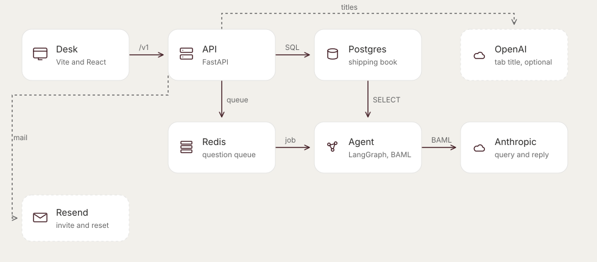
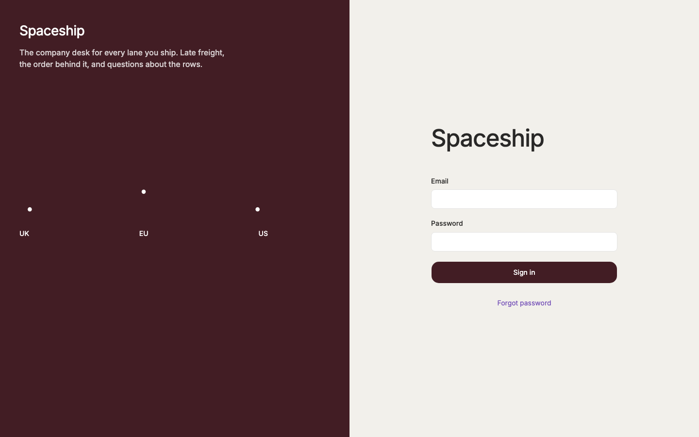
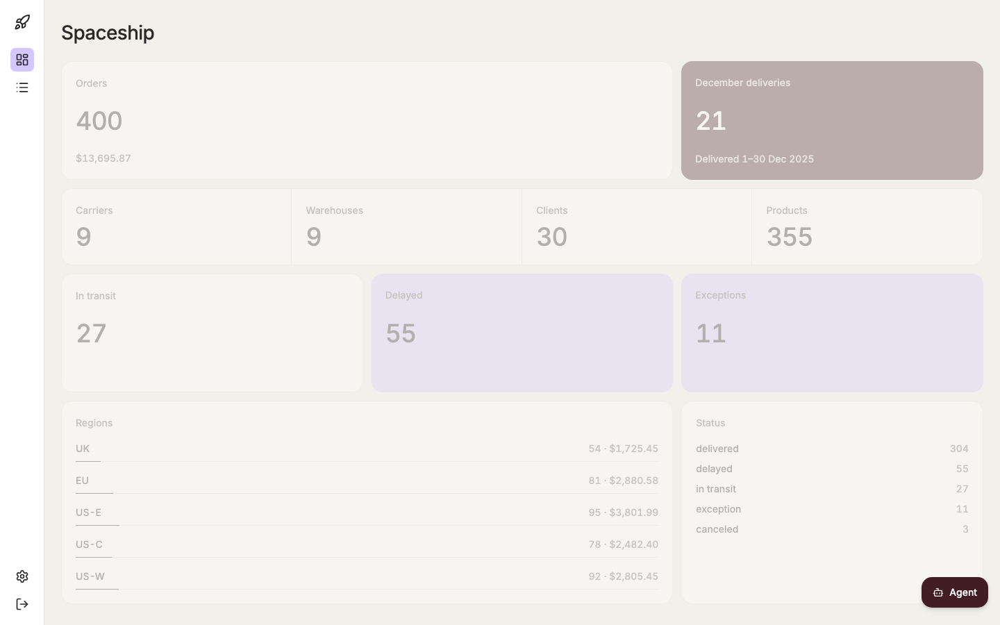
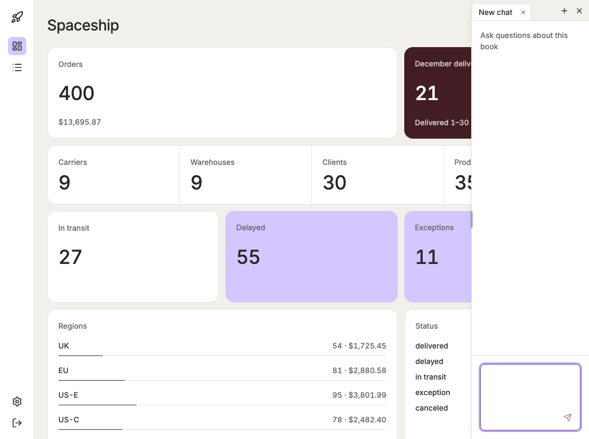
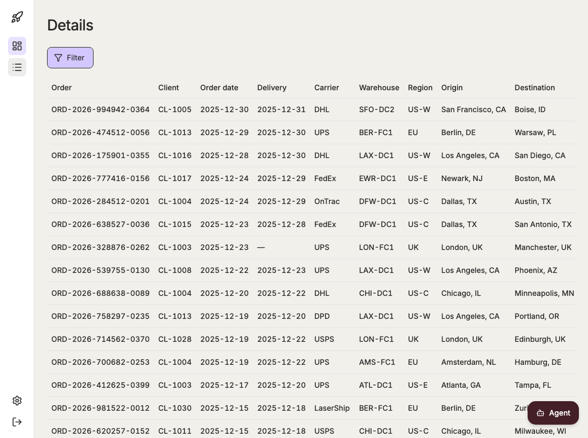
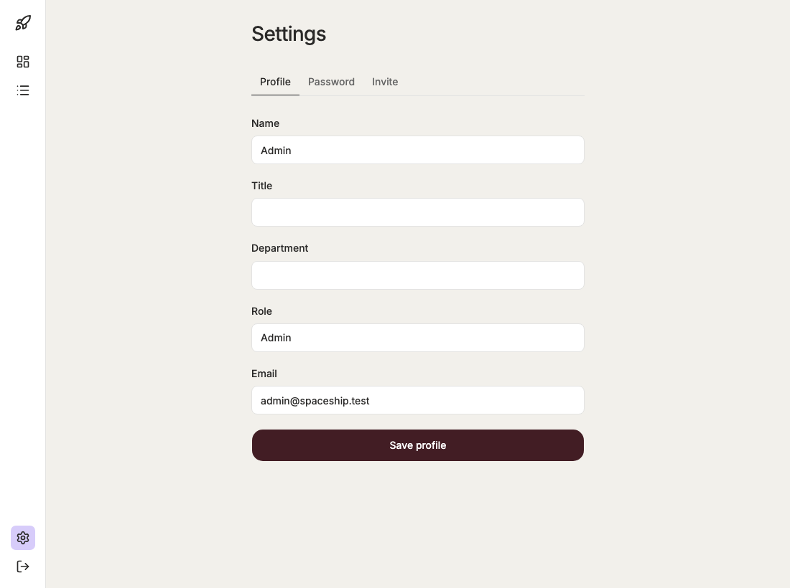

# Spaceship

Internal desk for the 2025 shipping book: 400 stationery orders, nine carriers, nine warehouses, 1 Jan through 30 Dec 2025. You see what is late, read the orders, and ask a question about the rows.

The walkthrough is [docs/using.md](docs/using.md). Design, HTTP, sign-in, and architecture notes are in [docs/design.md](docs/design.md), [docs/api.md](docs/api.md), [docs/auth.md](docs/auth.md), and [docs/architecture.md](docs/architecture.md).

## Architecture

The desk calls one API. The API reads the book in Postgres. A question waits on Redis until the agent worker runs a LangGraph tool chain: BAML chooses query or forecast, then either writes and runs a checked SELECT or computes a demand forecast in Python, then explains the result. OpenAI names the chat tab, and Resend sends invite and reset mail. Those two are skipped when their keys are empty.



## The desk

Sign in, then use the left rail. **Dashboard** is the summary. **Details** is the order table. **Settings** is your profile. **Agent**, at the bottom right, asks a question about the book.











## Run locally

```bash
pnpm install
uv sync
cp .env.example .env
```

Put a `JWT_SECRET` of at least 32 bytes in `.env`. Seed reads `BOOTSTRAP_ADMIN_EMAIL`, `BOOTSTRAP_ADMIN_PASSWORD`, `BOOTSTRAP_MEMBER_EMAIL`, and `BOOTSTRAP_MEMBER_PASSWORD` from that file. Passwords need at least 8 characters. Postgres is published on port **54329** so it does not collide with anything already listening on 5432.

```bash
pnpm db:create
pnpm db:migrate
pnpm db:seed
pnpm dev
```

- Desk: http://localhost:5173
- API: http://127.0.0.1:8000
- OpenAPI: http://127.0.0.1:8000/docs

The summary and the order table work with no model key. A question needs three more pieces: `ANTHROPIC_API_KEY`, a Redis URL, and the agent worker. `OPENAI_API_KEY` is optional and only names the chat tab.

```bash
docker run -d --name spaceship-redis -p 6379:6379 redis:7-alpine
```

Set `REDIS_URL=redis://localhost:6379/0` in `.env`, restart `pnpm dev`, then in another terminal:

```bash
uv run python -m src.agent.worker
```

Until those are set, the agent replies that questions are unavailable. It does not show a stack trace.

## Deploy

Actions → **deploy** → **Run workflow**, then choose the branch in **Use workflow from**. That run creates Postgres, Redis, the API, the agent, and the web service if they are missing, then uploads the API, agent, and web images from the selected branch. `ci` does not deploy.

The API pre-deploy command applies pending Alembic revisions, then loads the shipping book only when `orders` is empty. A database that already has orders is left as it is.

The Railway project must be named `spaceship`. That run writes `WEB_ORIGIN` on the API to the web service URL, which invite and reset links use. Repository secrets `RAILWAY_TOKEN`, `JWT_SECRET`, `BOOTSTRAP_ADMIN_EMAIL`, `BOOTSTRAP_ADMIN_PASSWORD`, `BOOTSTRAP_MEMBER_EMAIL`, and `BOOTSTRAP_MEMBER_PASSWORD` are required. `ANTHROPIC_API_KEY`, `OPENAI_API_KEY`, `RESEND_API_KEY`, and `RESEND_FROM` are optional. `RAILWAY_TOKEN` is an account or workspace token from [railway.com/account/tokens](https://railway.com/account/tokens). The workflow uses it to prepare the project, then mints a project token for the CLI upload. Leave `RAILWAY_WORKSPACE` unset unless more than one project is named spaceship.

## Scripts

| Script | What it does |
| --- | --- |
| `pnpm dev` | API and Vite together |
| `pnpm db:create` | Start Postgres from `infra/compose/docker-compose.yml` |
| `pnpm db:make -- "message"` | Alembic autogenerate |
| `pnpm db:migrate` | `alembic upgrade head` |
| `pnpm db:seed` | Load `scripts/bootstrap/data/*.json`, then the desk users from the environment |
| `pnpm db:export` | Rebuild those JSON files from `docs/manuals/mock_logistics_data.csv` |

Python checks: `uv run ruff check`, `uv run ruff format --check`, `uv run mypy`, `uv run pytest`.

Web checks: `pnpm --filter web typecheck` and `pnpm --filter web test`. A Playwright spec lives in `apps/web/e2e` and is meant to be run locally with `pnpm --filter web test:e2e` while `pnpm dev` is up.
