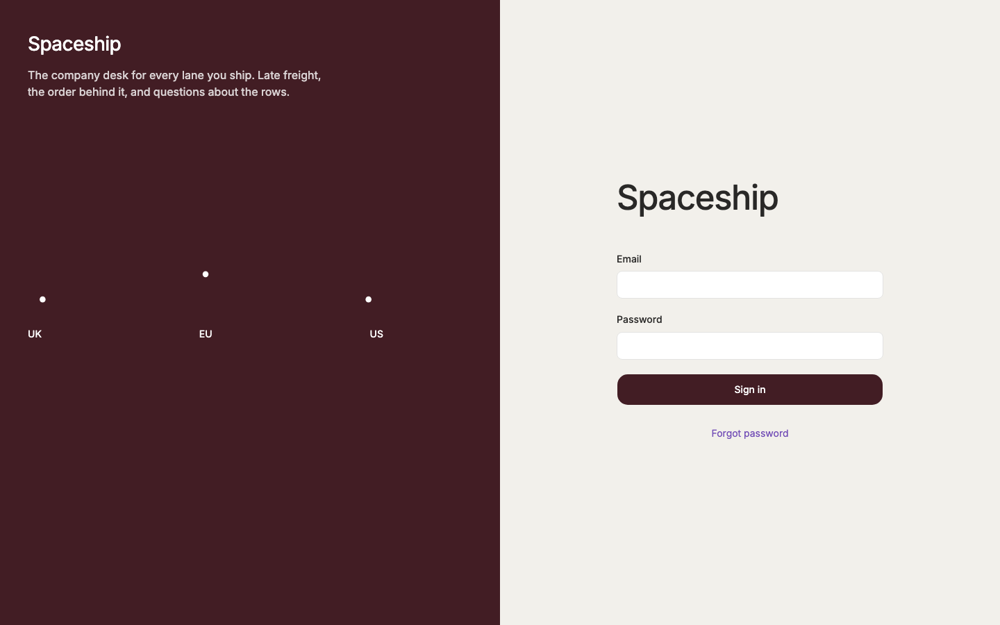
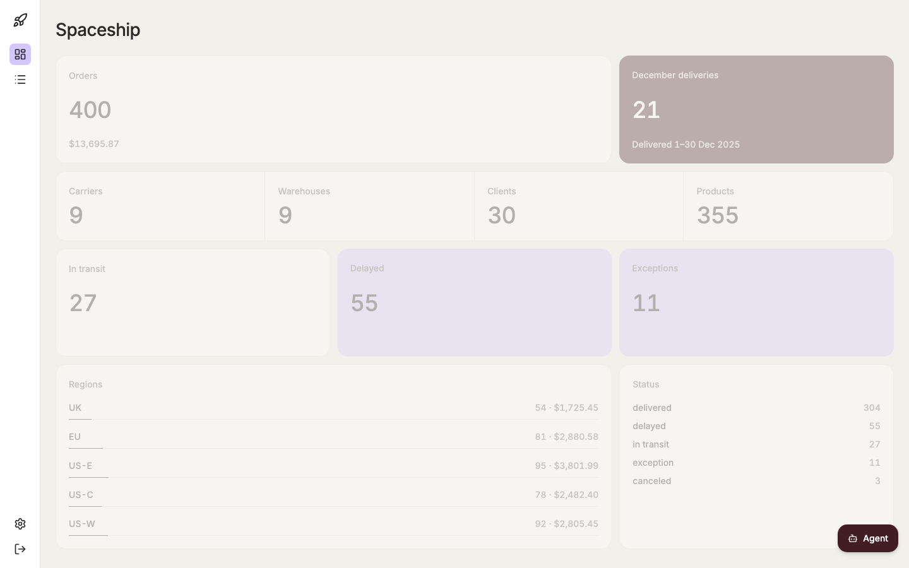
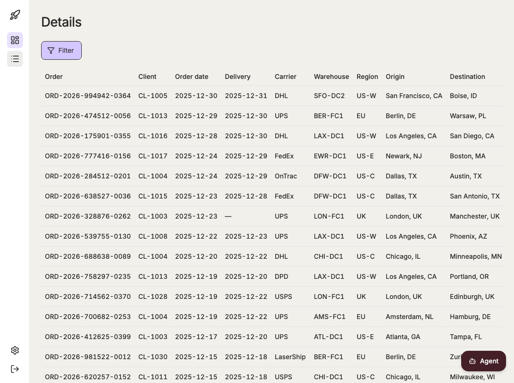
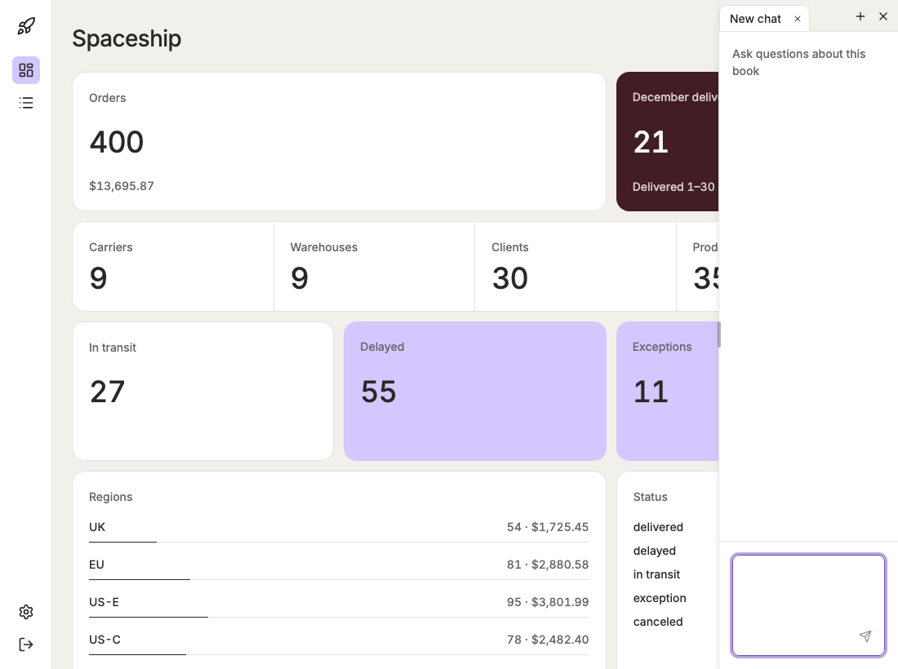
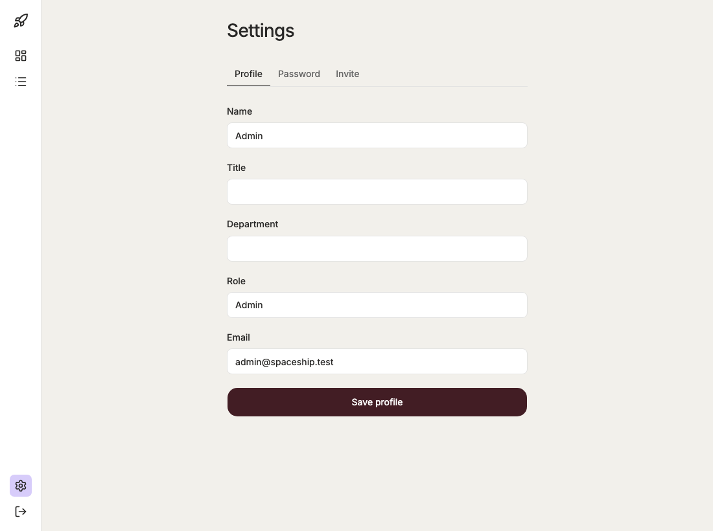

# Using the desk

Spaceship is one shipping book, not a place to create orders or talk to carriers. The book is 400 stationery orders from 1 Jan 2025 through 30 Dec 2025. Treat 30 Dec 2025 as today when you ask about "this month" or "last month."

Sign in at `/login`. `/` sends you to the dashboard. A missing session sends you back to sign in. The error under the form is one sentence for an unknown email and a wrong password.

The left rail is the same on every signed-in page.

| Control | Where it goes |
| --- | --- |
| Dashboard | The summary |
| Details | The order table |
| Settings | Your profile, password, and, for an admin, invites |
| Sign out | Ends the session |
| Agent | Opens the question panel over the page you are on |

On a narrow screen the rail sits along the bottom.

## Dashboard

The dashboard is the state of the book, not a chart you configure.

| Figure | Meaning |
| --- | --- |
| Orders | All 400 orders, and their value in USD. Value is quantity times unit price. The promo percent is recorded and is not applied. |
| December deliveries | Orders delivered from 1 Dec through 30 Dec 2025. |
| Carriers, warehouses, clients, products | How many of each are in the book: 9, 9, 30, and 355. |
| In transit, delayed, exceptions | Counts of those statuses. Canceled orders are in the status list, not in these three tiles. |
| Regions | Orders and value for UK, EU, US-E, US-C, and US-W. Region comes from the warehouse. An order has no region of its own. |
| Status | Delivered, delayed, in transit, exception, and canceled. |

## Details

Details is every order, forty at a time. Previous and Next move by that page.

Each row is one order: id, client, order date, delivery date, carrier, warehouse, region, origin, destination, status, SKU, category, quantity, unit price, value, and promo. A missing delivery date is shown as a dash. That is the in-transit and canceled orders.

**Filter** adds a chip. The chip names the column, the operator, and the value, and opens a panel for those three. Click the chip to edit it. Several chips apply together. Escape or a click outside closes the panel and leaves the filter in place. Remove a chip with its close control. If nothing matches, the page says "No orders match these filters." and keeps the chips.

Operators depend on the column. Text can contain or equal. Dates can be on, before, after, or empty. Numbers can equal, be greater than, or be less than. Status and promo use "is." Status values are `delivered`, `delayed`, `in_transit`, `exception`, and `canceled`.

## Agent

**Agent** opens a panel on the right. Drag the handle on its inner edge, or focus the handle and use the arrow keys, to change the width. The default is 480px. The panel remembers the width in this browser. A new chat starts from the plus button. Each tab can be closed. Closing the last tab leaves an empty chat. Conversations stay in this browser after a refresh.

Ask questions in plain language, then send one. Examples that match the book:

- How many orders were delayed?
- Which carrier delivered the most in the UK?
- Plot order value by region.

The reply is a short paragraph, plus how it was computed: tool, filters, metrics, dimensions, the plan (SQL or forecast method), and the rows behind the answer. Ask for several plots or mix a past query with a forecast in one question; the agent can call both tools and return more than one chart. If no plot is needed, none is shown. Click a preview to open Plot and Data. A line or area is for time, a bar is a comparison, a pie is a small share of a whole, and a scatter is two numbers.

The question goes to the API, which waits for the agent. The desk, the table, and the summary do not need that. A question does. Set `ANTHROPIC_API_KEY`, point `REDIS_URL` at Redis, and run `python -m src.agent.worker`. Without them the reply is "Questions are unavailable until an Anthropic key is configured." and there is no plot. With `OPENAI_API_KEY`, the tab is renamed from the first question. Without it, the tab keeps that question as its title.

Escape closes the panel.

## Settings

**Profile** edits your name, title, and department. Role and email are fixed.

**Password** asks for the current password and a new one of at least 8 characters.

**Invite** is only on an admin account. It sends a set-password link. That needs `RESEND_API_KEY`. Until a domain is verified, mail from `onboarding@resend.dev` only arrives at the address on the Resend account. The invited person opens the link, sets a password, and then signs in like everyone else.

**Forgot password** on the sign-in page sends the same kind of link, and also needs Resend.
